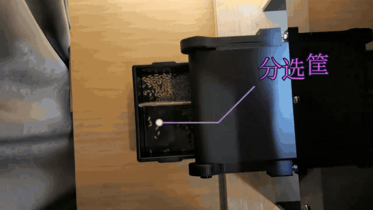
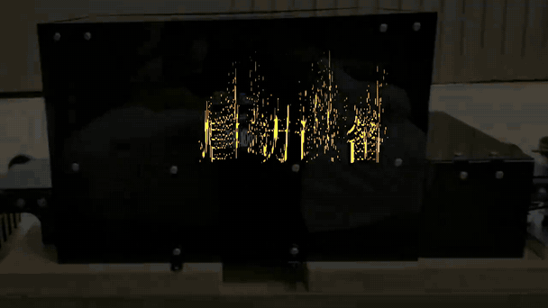
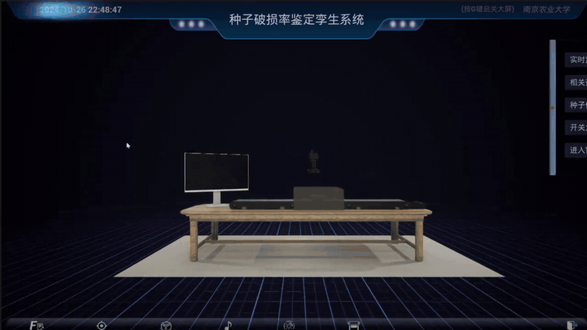

# Seed Sorting and 3D Digital Twin Visualisation

**Student Research Training Programme** · Project Principal · Nov 2022–Jun 2024

I led the project and independently built both the hardware and software for the seed sorting prototype. My work covered hardware design, deep-learning research for sorting decision support, 3D modelling, and development of the digital-twin visualisation and inspection dashboard.

## Project demos

### Sorting Hardware Overview

A closer look at the sorting chamber, conveyor and vibratory feeder.

### Prototype Start-Up

The recording shows the assembled unit being switched on, with the feeder and on-device display in view.

### 3D Digital Twin and Inspection Dashboard

The digital twin shows the equipment from different angles alongside per-seed inspection results and summary statistics on seed damage.

